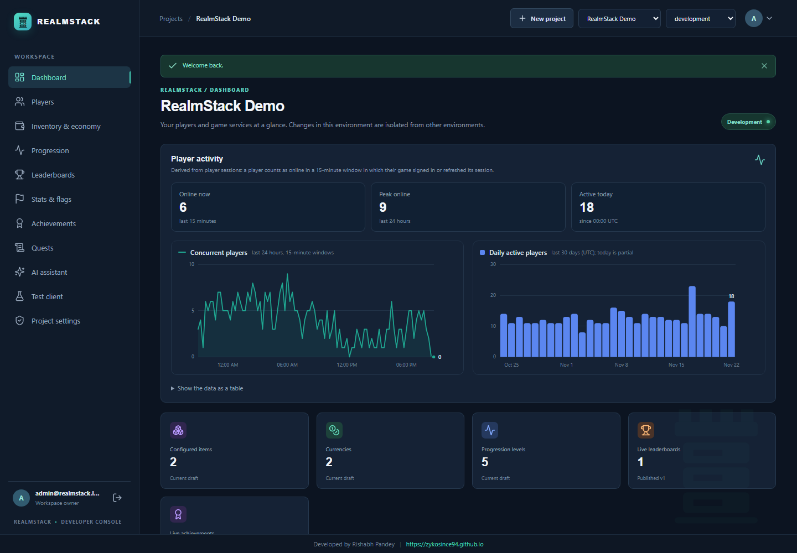
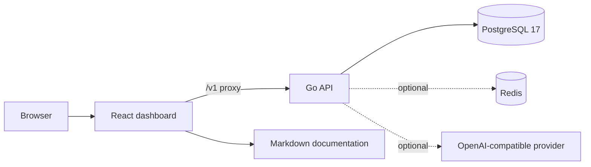
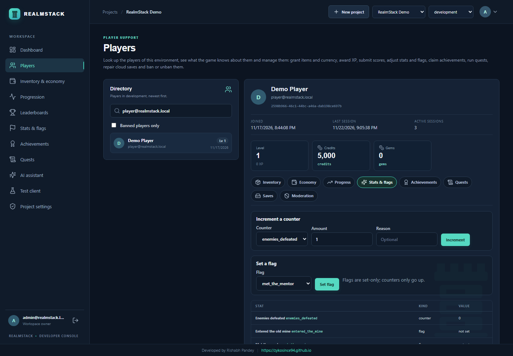
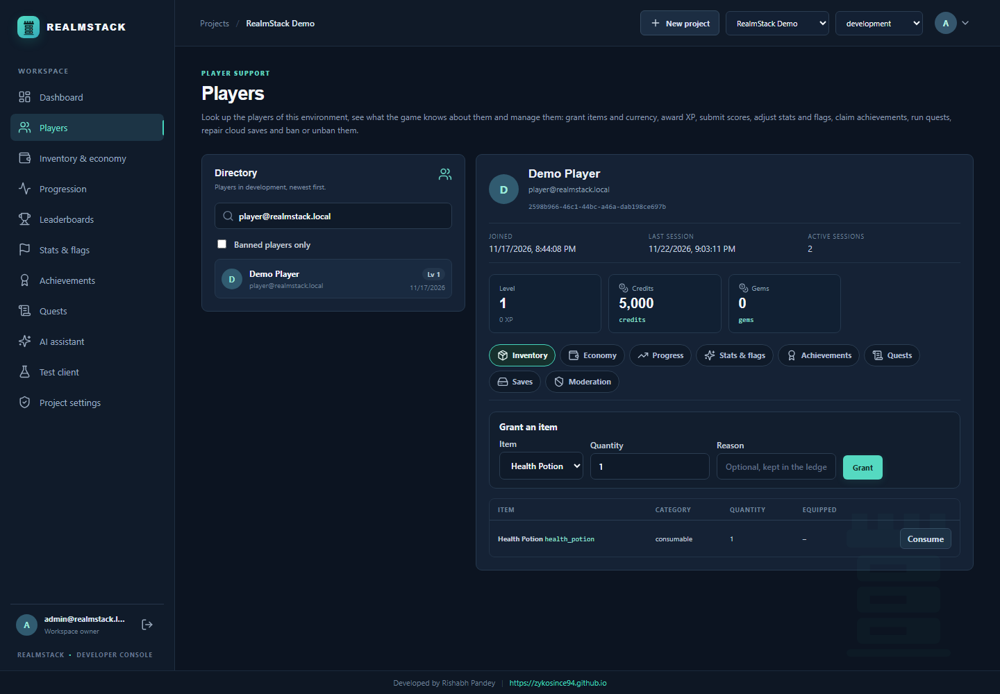
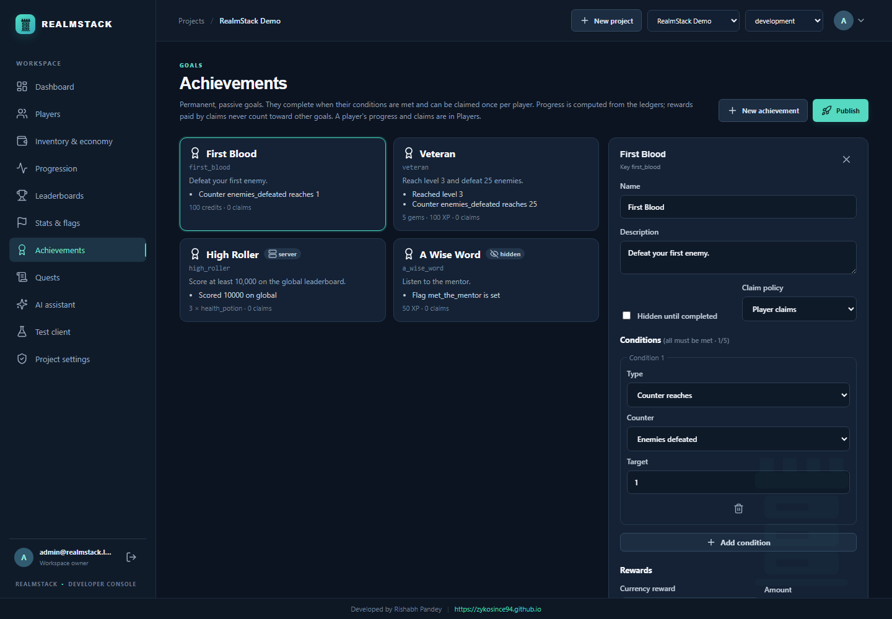
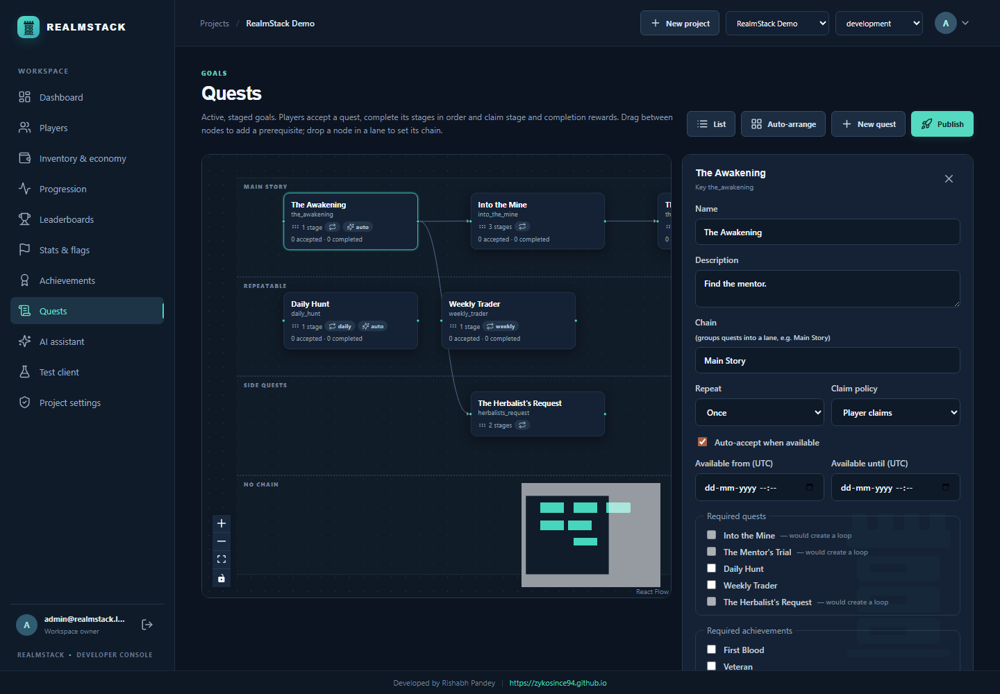
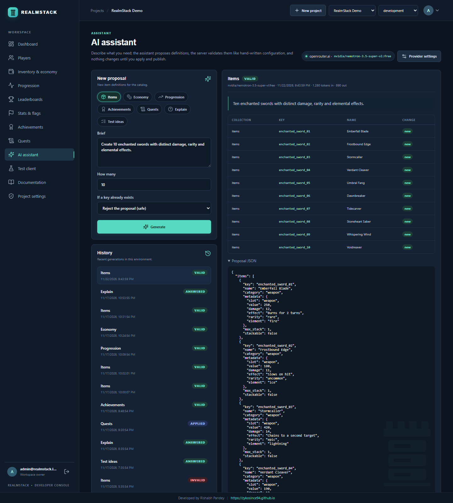
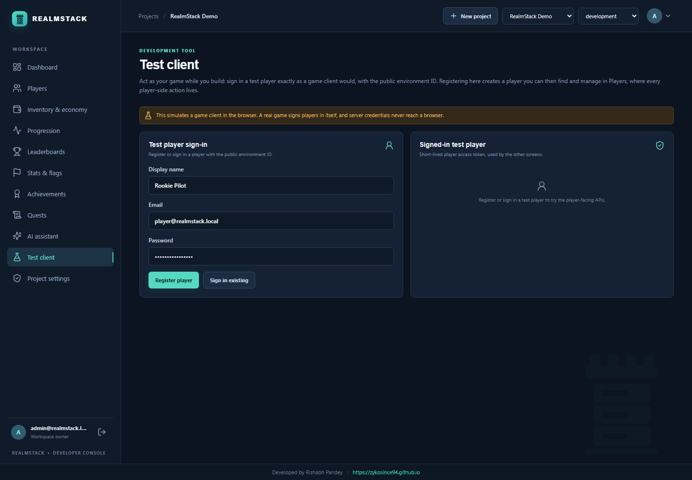
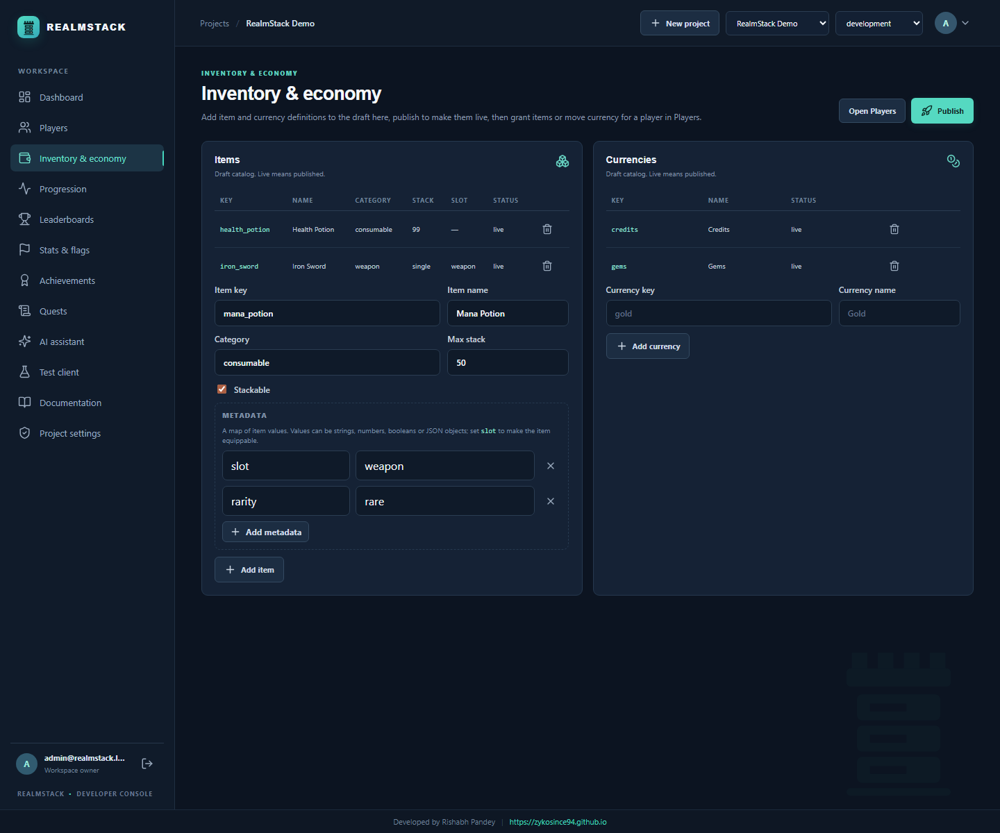
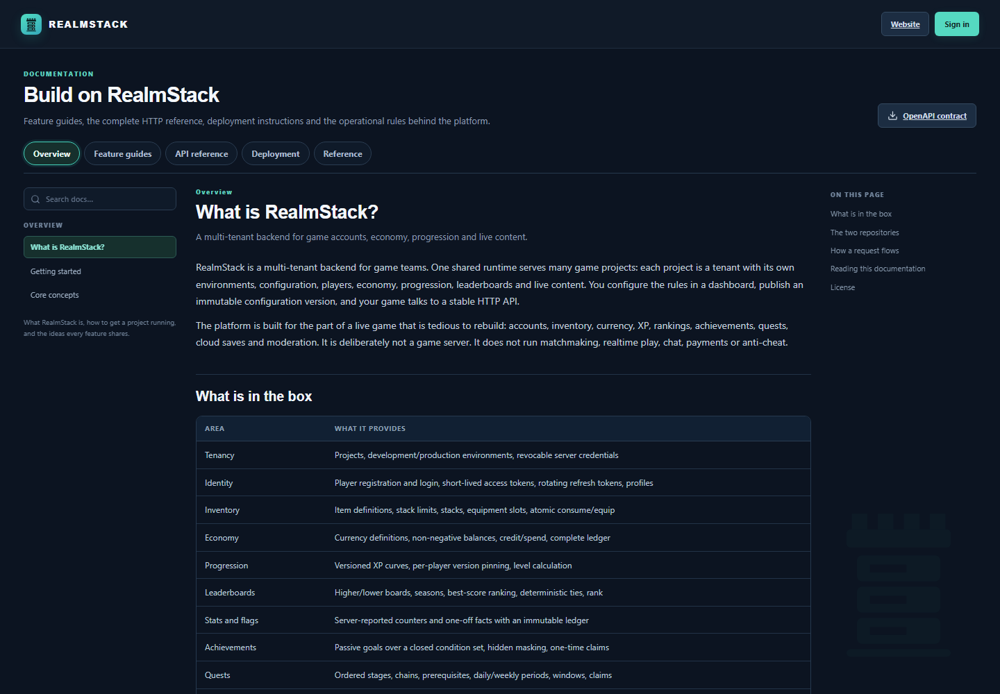

# RealmStack Dashboard


**The control plane for a multi-tenant game backend — configure the economy, inspect players and ship live content without redeploying.**

RealmStack is a multi-tenant backend for player identity, inventory, economy, progression, leaderboards, stats, achievements, quests, cloud saves and bans. This repository is the React dashboard and the integrated Docker Compose demo. The Go API lives in the [RealmStack backend repository](../realmstack-backend).



[Features](#feature-map) · [Tech stack](#tech-stack) · [Screens](#screens) · [Quick start](#quick-start) · [Self-hosting](#self-hosting) · [Documentation](#documentation) · [Project layout](#project-layout)

## Why it stands out

- **Everything is tenant-scoped.** Switch projects and environments without leaking state between them; every query is keyed by the active scope.
- **Draft → validate → publish.** Edit definitions safely, see field-level validation, publish immutable versions and roll back without rewriting history.
- **Players are first-class.** Search the directory, inspect inventory, economy, progress, stats, achievements and quests, then perform every game action from one place.
- **A real quest editor.** Build chains, stages, prerequisites and rewards on a React Flow canvas with lanes, auto-layout and cycle prevention.
- **AI proposes, you decide.** Bring your own OpenAI-compatible key, review a validated proposal, apply it to the draft and publish explicitly.
- **Docs built in.** The complete feature and HTTP reference is available before sign-in, inside the dashboard and as a downloadable OpenAPI contract.

## Feature map

| Surface | What it gives you |
|---|---|
| Dashboard | Online now, 24-hour peak, active today, CCU and DAU charts with keyboard, hover and table views |
| Players | Searchable directory, profile, balances, inventory, progression, stats, achievements, quests, saves and moderation |
| Inventory & economy | Draft catalog for items with metadata maps, currencies, live/draft status and publish |
| Progression | XP threshold editor, level preview and version-pinned behaviour |
| Leaderboards | Direction, season, top scores and board configuration |
| Stats & flags | Server-reported counters and flags, plus definition management |
| Achievements | Condition builder, rewards, hidden goals, claim policy and claim statistics |
| Quests | React Flow canvas, stages, prerequisites, periods, windows and rewards |
| AI assistant | Provider settings, generation history, proposal review and draft apply |
| Test client | Registers or signs in a demo player exactly as a game client would |
| Documentation | Public and in-dashboard guides, HTTP reference, deployment and operations |
| Project settings | Environments, server credentials, publish, versions, rollback, import/export and AI provider settings |

## Tech stack

| Layer | Choice | Why it is here |
|---|---|---|
| UI | **React 19** | Mature ecosystem, hooks, first-class concurrent rendering and a small component model |
| Language | **TypeScript ~5.8 strict** | Generated API types, refactor safety and errors at compile time instead of in a live game |
| Build | **Vite 7** | Instant dev server, native ESM, tiny config, efficient lazy chunks |
| Server state | **TanStack Query 5** | Scope-keyed caches, invalidation after mutations, retries and loading/error states without global-store boilerplate |
| API client | **`openapi-fetch` + `openapi-typescript`** | Types generated directly from the backend contract; no hand-written request or response models |
| Navigation | **Workspace state (no router)** | A compact administrative app with screen state, not URL-driven pages; documentation uses a single hash route |
| Quest canvas | **React Flow + dagre + dnd-kit** | Graph editing, automatic layout and accessible drag interactions, lazy-loaded only when needed |
| Docs renderer | **`react-markdown` + `remark-gfm`** | Contributor-friendly Markdown with tables and fenced code; no React rewrite for every guide |
| Icons | **lucide-react** | Consistent SVG icons with tree-shaking and simple sizing |
| Styling | **Plain CSS** | Full control of the dark console design, no runtime CSS engine, one predictable stylesheet |
| Charts | **Hand-drawn SVG** | No chart dependency; accessible hover, keyboard readout and a table view in a tiny bundle |
| Tests | **Vitest 4 + Testing Library + jsdom** | Fast unit and DOM tests on the same Vite pipeline as the app |
| Lint | **ESLint 9** | Flat config, TypeScript rules and a zero-warning gate |
| Packaging | **Docker Compose + Vite** | One command runs the dashboard and builds the API from a local backend checkout |

## Architecture



Server data lives in TanStack Query keyed by project and environment. Mutations invalidate exactly what changed. Player actions live in the Players screen and call dashboard-token admin routes; configuration screens never carry player state or server credentials.

## Screens

<p align="center">
  
  
</p>
<p align="center">
  
  
</p>
<p align="center">
  
  
</p>
<p align="center">
  
</p>
<p align="center">
  
</p>

## Quick start

### Full stack: dashboard + API + PostgreSQL

Clone the [backend repository](../realmstack-backend) into the same parent folder as this one (`realmstack-backend/` beside `realmstack-frontend/`), then run this from `realmstack-frontend/`:

```sh
cp .env.example .env
docker compose up -d --build --wait
```

| Service | URL |
|---|---|
| Dashboard | http://localhost:5174 |
| API | http://localhost:8080 |
| Health | http://localhost:8080/healthz |
| Documentation | http://localhost:5174/#/docs |
| PostgreSQL | `127.0.0.1:5434` |

Containers: `realmstack-db-1`, `realmstack-api-1`, `realmstack-web-1`. Images: `realmstack-api:local`, `realmstack-web:local`. Data volume: `realmstack_db-data`. All ports bind to loopback.

Local-only demo credentials:

| Purpose | Value |
|---|---|
| Dashboard | `admin@realmstack.local` / `RealmStackLocal!2026` |
| Clean workspace | `admin` / `RealmStackLocal!2026` (no projects) |
| Player | `player@realmstack.local` / `PlayerLocal!2026` |
| Public environment ID | `pub_realmstack_demo_dev` |
| Demo server credential | `rs_demo.realmstack-local-server-secret` |

Do not expose this stack to the internet or reuse these credentials outside a disposable environment.

To reset the demo database:

```sh
docker compose down -v
docker compose up --build
```

`down -v` deletes the local database volume. Do not run it if you need the data.

### Frontend only

```sh
npm ci
npm run dev
```

Open <http://localhost:5173>. Vite proxies `/v1` to `http://localhost:8080`; set `VITE_API_PROXY_TARGET` to change it. `VITE_*` values are public browser configuration — never put secrets there.

Quality gates:

```sh
npm run lint
npm run typecheck
npm test
npm run build
```

## Self-hosting

The bundled Compose stack is a local demo. For a host you control, this repository includes the deployment files:

- [`docker-compose.selfhost.yml`](docker-compose.selfhost.yml) — API, static dashboard and optional Redis
- [`Dockerfile.selfhost`](Dockerfile.selfhost) — multi-stage dashboard build into nginx
- [`deploy/nginx.conf`](deploy/nginx.conf) — static fallback plus `/v1` and `/healthz` proxy
- [`.env.selfhost.example`](.env.selfhost.example) — database, JWT secret, proxy, Redis and AI settings

The **Self-hosting** page in the dashboard docs covers PostgreSQL, TLS, the first dashboard user, backups, Redis consistency and AI setup.

## Documentation

The documentation site is available at `#/docs` from the sign-in page and from the dashboard sidebar and account menu. It covers the product model, every feature, the complete HTTP reference, deployment and operations. Content is Markdown under `src/features/docs/content/`; the API contract can be downloaded from the page sidebar.

After a backend contract change:

```sh
npm run generate:api   # regenerate src/api/generated/schema.ts
npm run sync:openapi   # copy the contract to public/openapi.yaml
npm run check:openapi  # verify that copy matches the backend contract
```

Then update the human API reference when routes or behaviour changed.

## Project layout

```text
src/main.tsx                 React root + TanStack Query provider
src/app/                     App shell, workspace context, account menu, query client
src/api/generated/schema.ts  generated from ../realmstack-backend/api/openapi.yaml; never edit
src/api/client.ts            typed openapi-fetch client, unwrap(), authHeaders(), idempotencyKey()
src/api/errors.ts            ApiError, describeError, expired-session detection
src/hooks/queries.ts         query keys and hooks for every scoped resource
src/lib/                     pure helpers: config, quests, AI, charts, docs
src/features/dashboard/      player activity and charts
src/features/players/        directory, profile, player actions, saves, moderation
src/features/economy/        item and currency catalog editors
src/features/progression/    XP curve editor
src/features/leaderboards/   board configuration and top scores
src/features/stats/          stats and flags definitions
src/features/achievements/   achievement list and editor
src/features/quests/         lazy-loaded React Flow quest canvas and editor
src/features/ai-config/      lazy-loaded AI assistant and provider panel
src/features/settings/       environments, credentials, publish, versions, import/export
src/features/docs/           Markdown documentation, tabs, TOC, search
src/features/test-client/    register/sign in a demo player like a game client
src/test/                    fetch mock, fixtures, renderApp(), jsdom helpers
public/screenshots/          README and documentation screenshots
docker-compose.selfhost.yml  self-hosted API + static dashboard
Dockerfile.selfhost          multi-stage dashboard build into nginx
deploy/nginx.conf            static serving + /v1 and /healthz proxy
.env.selfhost.example        self-hosting environment template
```

## API contract and repository relationship

This is an independent Git repository, but the two projects share a contract:

- `npm run generate:api` reads `../realmstack-backend/api/openapi.yaml` when both repositories are checked out side by side; the generated client is committed so CI and `npm run build` work without the backend checkout.
- The integrated Compose file builds the API from that local backend checkout.
- The backend's route test fails if the OpenAPI document and the real routes disagree in either direction.

See the [RealmStack backend repository](../realmstack-backend) for the Go API, migrations, load tests and contract.

## Security and quality

- Dashboard and player tokens are separate; a player token cannot call dashboard routes.
- Player actions from the dashboard use admin idempotency keys and the same domain handlers as the game.
- API errors are mapped to inline field errors; destructive actions require confirmation.
- Lint stays at zero warnings; TypeScript is strict; generated types prevent contract drift.
- `VITE_*` values are public. Server credentials stay on the backend.

## Contributing and security

See [`CONTRIBUTING.md`](CONTRIBUTING.md) for the development workflow, [`SECURITY.md`](SECURITY.md) to report a vulnerability privately, and [`CHANGELOG.md`](CHANGELOG.md) for release notes.

## License

Apache License 2.0. See [LICENSE](LICENSE) and [NOTICE](NOTICE).
